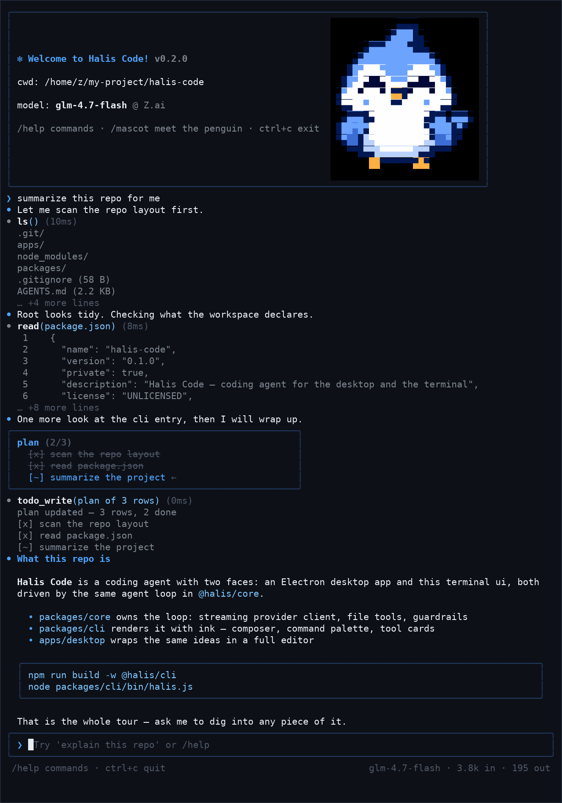
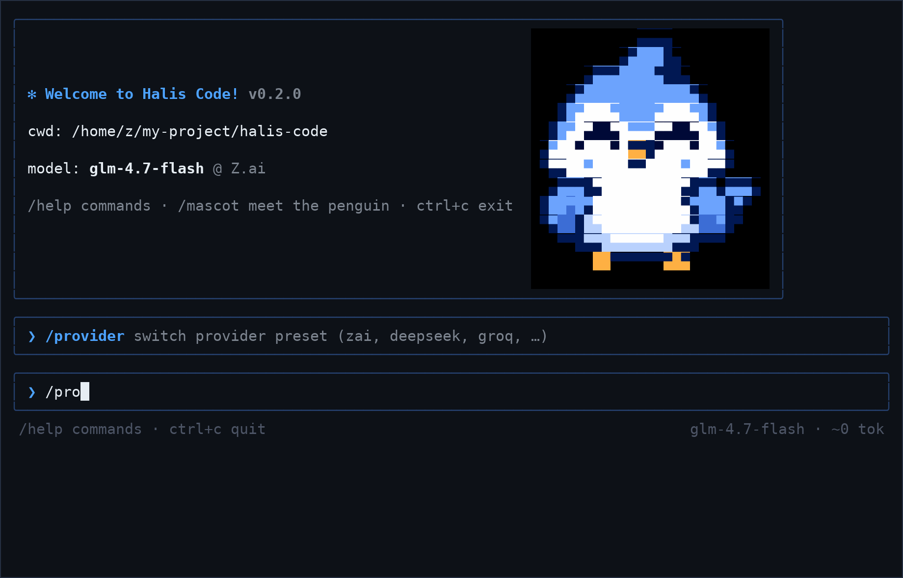
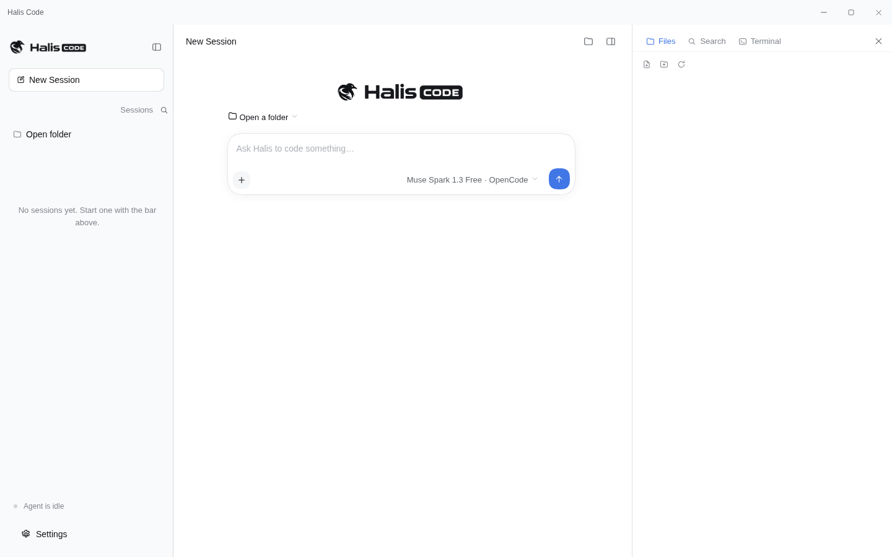
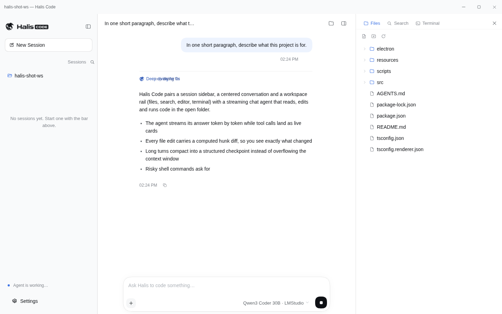
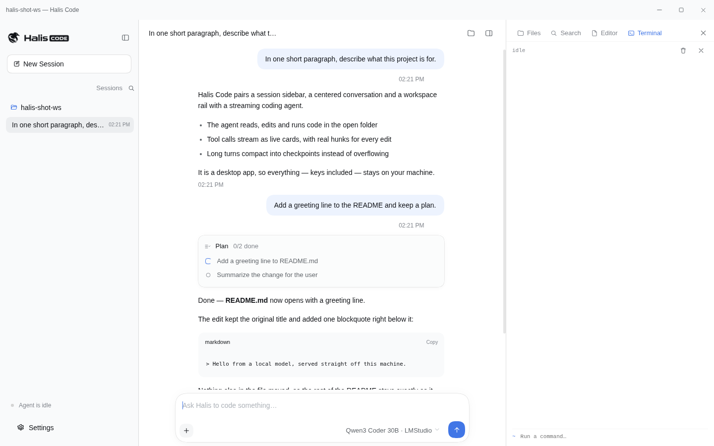
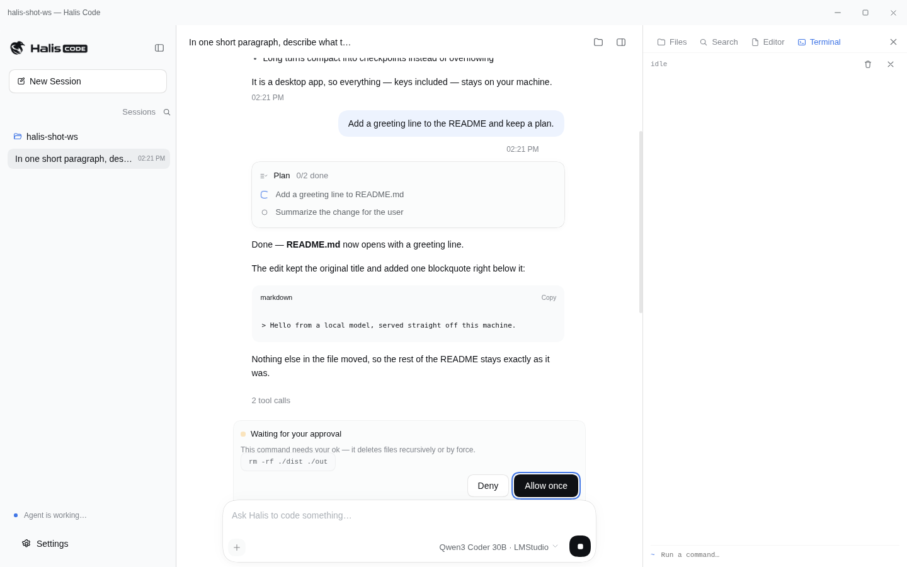
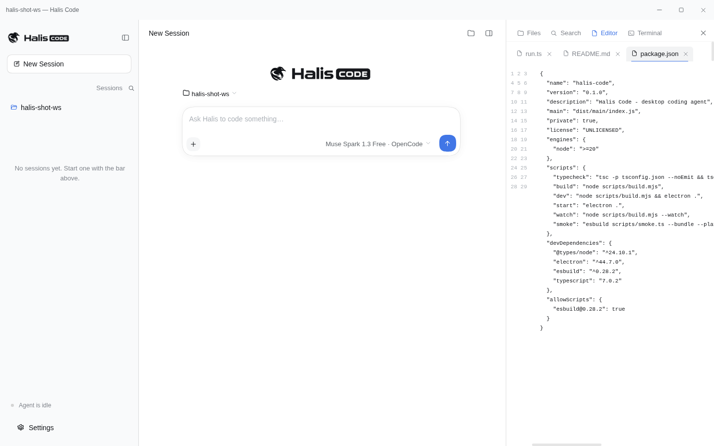
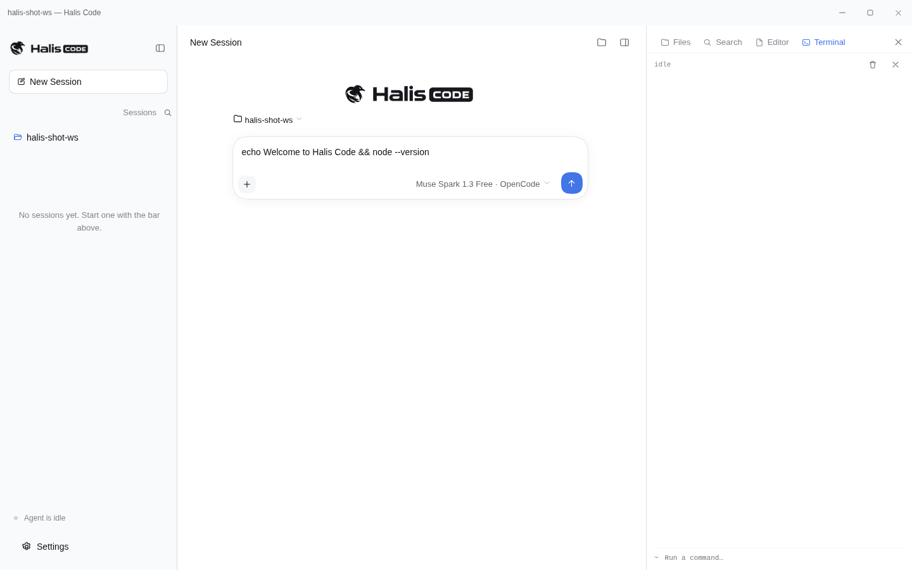
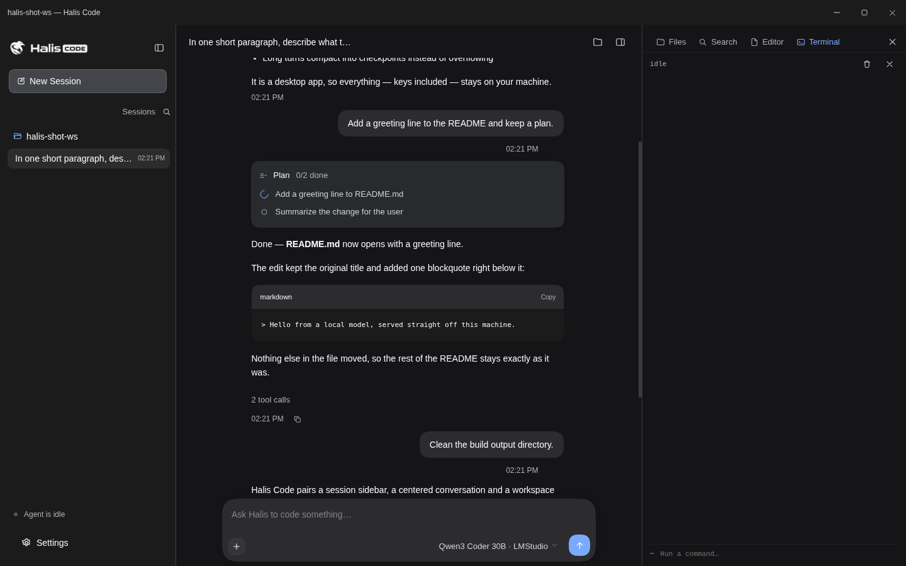
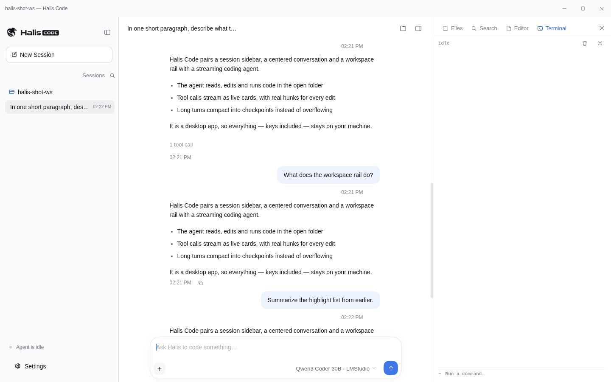

<div align="center">

# Halis Code

**A coding agent with guardrails — one agent, two faces: your terminal and your desktop.**

[](https://github.com/binhdzs1tg/halis-code/actions/workflows/ci.yml)
[](https://www.npmjs.com/package/halis-code)
[](#cross-platform)
[](#install)
[](https://github.com/binhdzs1tg/halis-code/actions/workflows/codeql.yml)
[](https://securityscorecards.dev/viewer/?uri=github.com/binhdzs1tg/halis-code)
[](LICENSE)

Halis Code streams an agent that reads, edits and runs code in your
project — and keeps its own context honest while it does: compaction
before the window fills, approvals before anything destructive runs, a
repeat guard against loops, and nothing ever lost to silent truncation.

[Install](#install) · [Terminal ui](#the-terminal-ui) · [Desktop app](#the-desktop-app) · [Docs](#documentation)

</div>

## Why another coding agent

Because most of them are either a terminal tool or a desktop app, and
the interesting failures happen in the long sessions: context that
fills up and quietly degrades, the same failing tool call repeated
eleven times, a `docker compose` output eating the whole window. Halis
Code treats those as the product:

- **Compaction with safe cut points** — when the transcript crosses the
  token budget, older history folds into a model-written summary. The
  cut never splits a tool call from its result, and a verbatim tail
  keeps the current task intact.
- **A repeat guard** — identical calls (canonicalized, so argument
  order cannot hide a repeat) earn escalating reminders at 3, 5 and 8,
  and a hard stop at 12.
- **Approvals that explain themselves** — every risky shell command
  asks first, with the reason on the card: "it deletes files
  recursively or by force", "it pipes command output into a shell", …
- **Spill, not truncation** — oversized tool output lands in a
  readable file with a preview and a pointer, so nothing disappears
  and nothing bloats the context.

## Install

**Terminal** (node 20 or newer):

```sh
npm install -g halis-code
halis
```

**Desktop** — grab the installer for your platform from the
[releases page](https://github.com/binhdzs1tg/halis-code/releases):
`.dmg` (macOS arm64 + x64), `.deb` / `.AppImage` (Linux), or the NSIS
`.exe` setup (Windows). The desktop app is unsigned for now — on macOS
that means the usual right-click → open on first launch.

**From source**:

```sh
git clone https://github.com/binhdzs1tg/halis-code.git
cd halis-code
npm install
npm run dev:cli        # terminal ui, watch mode
npm run dev:desktop    # build + launch the desktop app
```

## The terminal ui

`halis` opens a session that behaves like a terminal-first pair
programmer: a bordered composer with a command palette, a live spinner
while the model thinks, tool cards with durations and output previews,
bash approvals before anything destructive runs, and a status line
with model, context usage and session cost straight from the catalog.
The mascot — the Halis penguin — sits on the welcome screen, redrawn
pixel by pixel in truecolor half-blocks.



A few ways in:

```sh
halis                                       # interactive session
halis "fix the failing build"               # start with a prompt
halis -p "summarize this repo"              # answer once, then exit
halis -p --json "run the tests"             # one event per line, for scripts
halis -c                                    # continue the last session here
halis sessions                              # list stored sessions
halis mascot                                # the penguin, full size
```

Slash commands inside a session:

| command | what it does |
| ------- | ------------ |
| `/help` | list every command |
| `/model` | pick a model from the catalog (search + variants) |
| `/models` | the same picker, alias |
| `/provider` | switch provider preset (zai, deepseek, groq, …) |
| `/diff` | git diff of the working tree |
| `/compact` | compact the transcript now |
| `/resume` | pick an earlier session to load |
| `/title` | rename this session (auto-titled after turn one) |
| `/export` | write the transcript to markdown |
| `/usage` | token totals and estimated cost |
| `/skills` | list installed skills |
| `/yolo` | toggle command approvals off (careful) |
| `/doctor` | check config, key, catalog and endpoint |
| `/init` | write an `AGENTS.md` for the current repo |
| `/status` | config, key and session info |
| `/mascot` | say hi to the penguin |
| `/clear` | drop the conversation context |
| `/exit` | quit (or ctrl+c twice) |



Type `!command` to run something in your own shell, without the model
in the middle.

## Models and providers

The whole [models.dev](https://models.dev) catalog ships in the box:
200+ providers and 8,000+ models, bundled as a snapshot (so model
picking works offline) and refreshed in the background with ETag-cached
revalidation. Both wire protocols are supported — OpenAI-style chat
completions for most providers, Anthropic messages with thinking blocks
for the Anthropic family — chosen from catalog data instead of a
hand-listed table.

```sh
halis -m anthropic/claude-sonnet-4-5#high    # provider/model plus reasoning variant
halis -m glm-4.7-flash                       # bare ids search the favorites first
halis --yolo "run the whole migration"       # no approval prompts
```

Keys come from each provider's documented environment variable
(`ANTHROPIC_API_KEY`, `DEEPSEEK_API_KEY`, `ZAI_API_KEY`, …) or plain
`HALIS_API_KEY`; `HALIS_BASE_URL` + `HALIS_MODEL` reach anything
self-hosted, and the classic presets (`zai`, `deepseek`, `moonshot`,
`groq`, `openai`, `openrouter`, `ollama`) work through `/provider`.
Without a key the cli runs in a clearly labeled demo mode, so the
interface stays explorable.

The agent's toolkit: `ls`, `read`, `write`, `edit`, `glob`, `grep`,
`bash` (with `run_in_background` and timeout promotion to background
jobs), `job_output` / `job_kill`, `web_fetch` (refuses private
addresses), `web_search` (keyless, DuckDuckGo-backed), `todo_write`
(the plan card), `skill` (progressive-disclosure skills from
`.halis/skills/*/SKILL.md`), `ask_user` and `task` (a subagent that
explores with its own context and reports back).

Developing without a key works too — a scripted OpenAI-compatible
provider ships with the cli, and the ci pipeline runs the whole agent
loop against it for every push:

```sh
npm run mock -w halis-code                                     # listens on :8787
HALIS_BASE_URL=http://localhost:8787/v1 HALIS_API_KEY=mock \
  node packages/cli/bin/halis.js
```

## The desktop app

The Electron app pairs a session-list sidebar and a centered
conversation with a workspace rail — files, search, editor, terminal.
The same guardrails ride along, plus desktop-only machinery: the mcp
client, subagents, skill loading, patch application, and a provider
key vault behind Electron `safeStorage`.

- **Streaming agent** with live tool cards, plan todos and a message
  queue while a run is in flight.
- **Workspace rail** — explorer (create, rename, delete), editor with
  tabs and save, terminal panel, and search across the workspace.
- **Model catalog** with variants, a key dialog, settings, focus mode,
  dark theme, auto-titled sessions with history.

| | |
| --- | --- |
|  |  |
|  |  |
|  |  |
|  |  |

All twenty screenshots live in
[`apps/desktop/docs/screenshots`](apps/desktop/docs/screenshots).

## Cross-platform

The same code runs on macOS, Linux and Windows, and the ci matrix
tests all three on every push:

- **Shell** — commands go through the user's login shell on unix
  (`$SHELL`, falling back to the account shell, then `/bin/bash`) and
  through `cmd.exe` on Windows. Set `HALIS_SHELL` to force one — a
  posix-style `bash.exe` (git bash) is invoked with `-c`, `pwsh.exe`
  with `-NoProfile -NonInteractive -Command`, anything else must speak
  cmd. The system prompt tells the model which shell it has, so on
  Windows it writes `dir` and `%VAR%` instead of `ls` and `$VAR`.
- **Process trees** — timeouts and cancels kill the whole tree
  (process groups with SIGTERM-to-SIGKILL escalation on unix,
  `taskkill /T` on Windows), and a foreground command that outlives
  its timeout is promoted to a background job on every platform.
- **Files** — `read` shows CRLF files without the carriage returns,
  `edit` folds replacements into the line endings the file already
  uses, and glob matching follows the filesystem: case-insensitive on
  Windows and macOS, strict on Linux.

## Documentation

| doc | what it covers |
| --- | -------------- |
| [docs/architecture.md](docs/architecture.md) | how the pieces fit, and why |
| [docs/development.md](docs/development.md) | commands, smoke suites, adding tools, env vars |
| [docs/releases.md](docs/releases.md) | how a tag becomes installers and an npm package |
| [docs/security.md](docs/security.md) | the guardrails as a system — trust boundaries and all |
| [CHANGELOG.md](CHANGELOG.md) | what shipped, when |
| [CONTRIBUTING.md](CONTRIBUTING.md) | the short path to a merged pull request |
| [SECURITY.md](SECURITY.md) | reporting a vulnerability, scope |

## Development

TypeScript 7 everywhere, strict. From the root:

```sh
npm run typecheck      # all workspaces
npm run build          # cli (bundles core from source), then desktop
npm run dev:cli        # watch mode for the terminal ui
npm run dev:desktop    # build + launch the desktop app
npm run smoke -w @halis/core      # the terminal-side loop against a scripted provider
npm run smoke -w @halis/desktop   # algorithm smoke tests
npm run lint:md        # markdownlint over every md file
```

The everyday details — smoke suite internals, the mock provider, every
environment variable — are in
[docs/development.md](docs/development.md). Conventions for humans and
coding agents live in [AGENTS.md](AGENTS.md).

## Releases

Cutting a release is one step: push a semver tag (`v0.3.0`). The
release assembles itself — notes grouped from the commit log, installers
built on all three platforms, the npm package published with provenance.
The full pipeline is in [docs/releases.md](docs/releases.md).

## Security

Guardrails are the product, so they are documented like one:
[docs/security.md](docs/security.md) explains the trust boundaries
(approvals, the fetch guard, the hostile-renderer discipline, process
trees), and [SECURITY.md](SECURITY.md) explains how to report a hole in
any of them — privately, please.

## Contributing and license

Pull requests are welcome — [CONTRIBUTING.md](CONTRIBUTING.md) is the
short path, and the ci matrix will keep you honest on all three
platforms. MIT licensed; see [LICENSE](LICENSE).

The model catalog comes from [models.dev](https://models.dev) — this
repo just ships the snapshot and the picker around it. The terminal ui
is built on [Ink](https://github.com/vadimdemedes/ink-react) and React,
the desktop app on Electron, and everything compiles with TypeScript 7
in strict mode.
