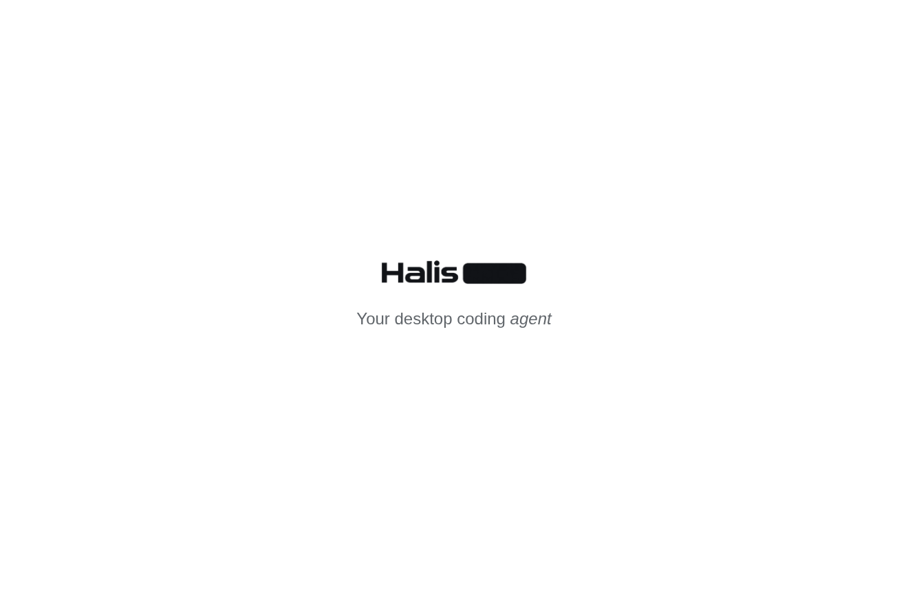
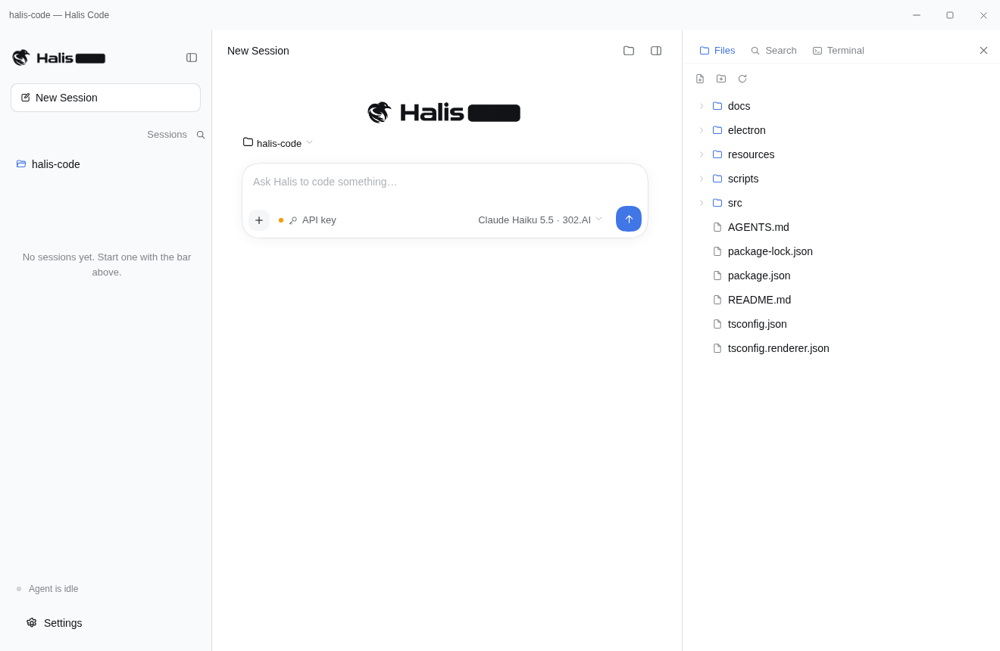
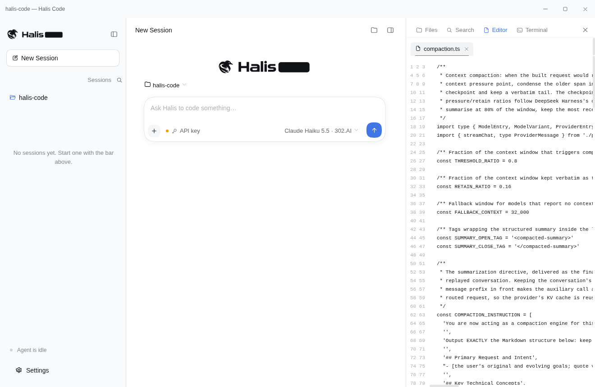
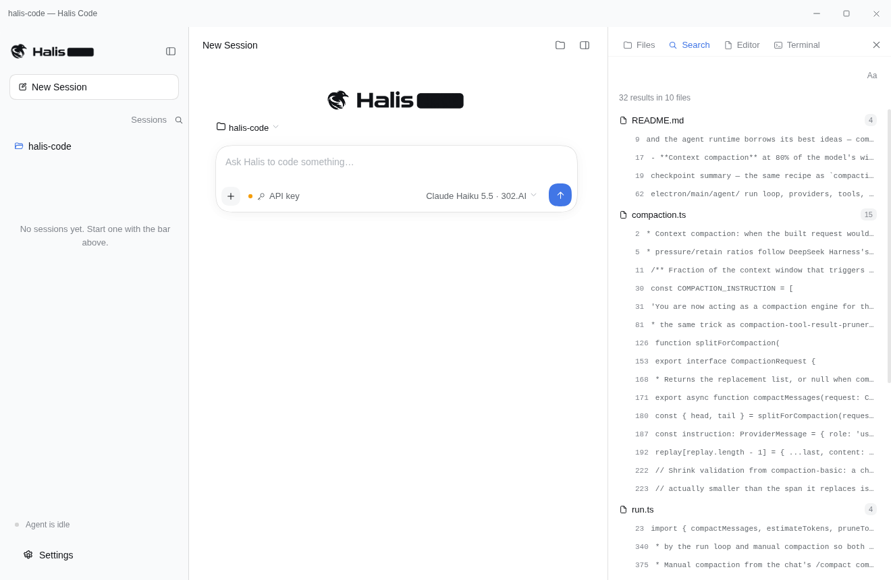
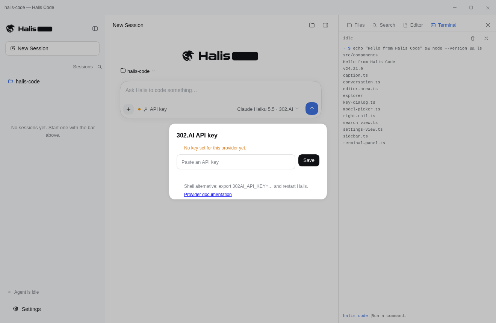
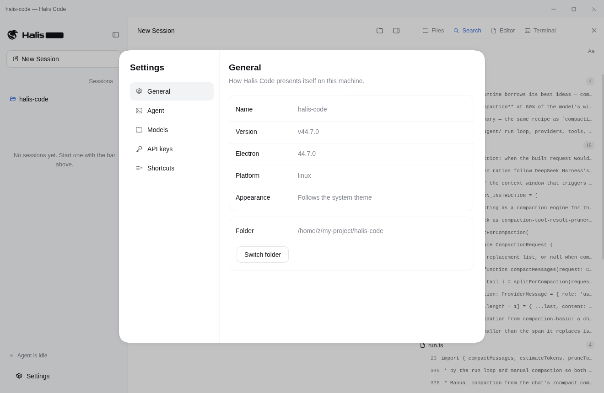
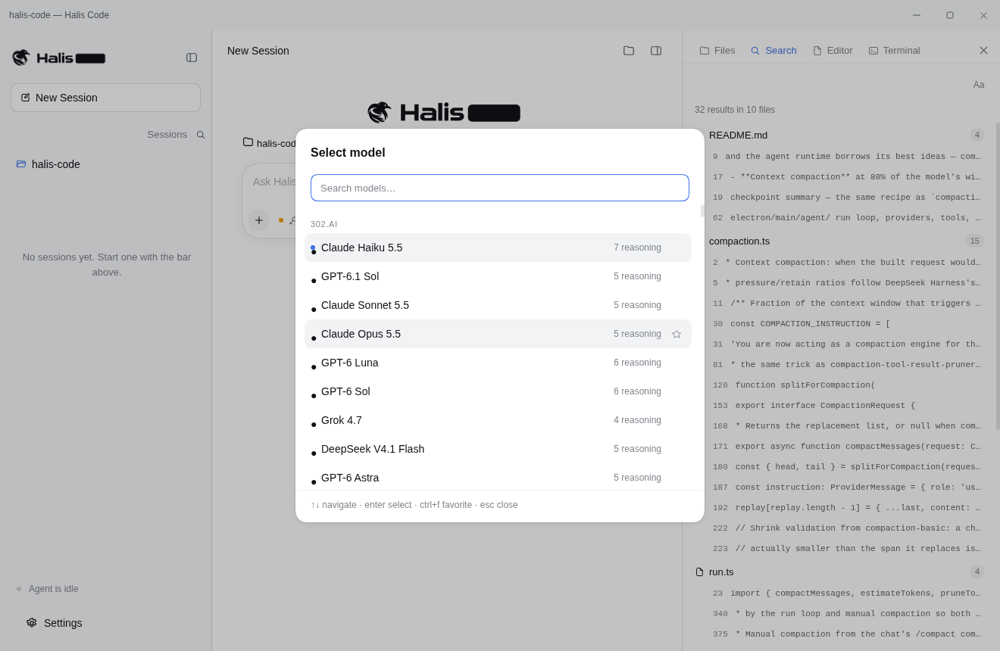
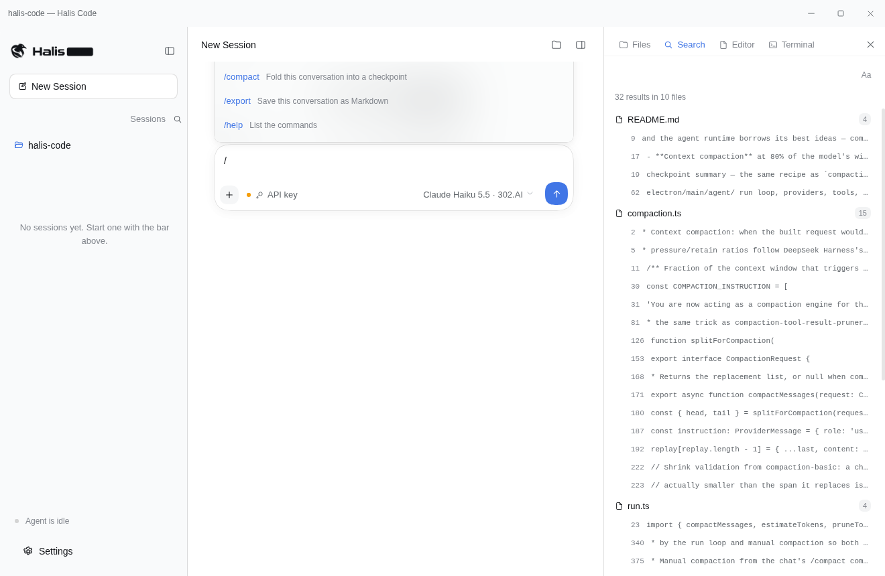
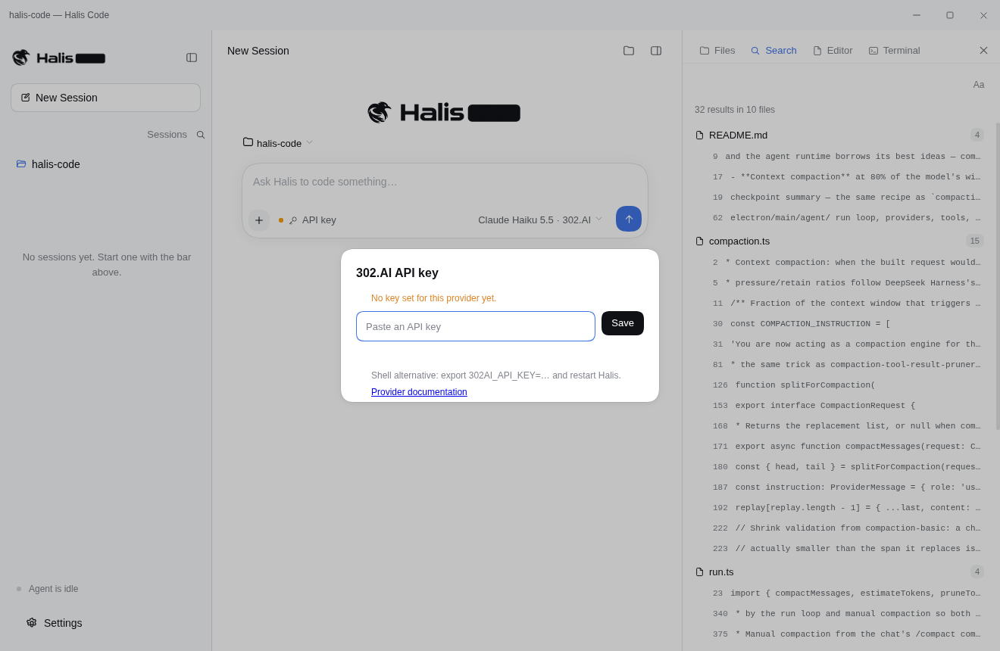

# Halis Code

Halis Code is a desktop coding agent built on Electron. It pairs a
session-list sidebar, a centered conversation and a workspace rail
(files, search, editor, terminal) with a streaming chat agent that
reads, edits and runs code in the open folder. The interface follows
the design language of
[DeepSeek Harness](https://github.com/deepseek-ai/deepseek-harness),
and the agent runtime borrows its best ideas — compaction, guards,
approvals, skills — scaled down to a single-user desktop app.

## Highlights

- **Streaming agent** with tool use (`list_dir`, `read_file`, `write_file`,
  `edit_file`, `search`, `run_command`, `todo_write`, `skill`), live tool
  cards, plan todos and a message queue while a run is in flight.
- **Context compaction** at 80% of the model's window with a 16% verbatim
  tail, tool-pair-safe cut points, a shrink check and an 8-section
  checkpoint summary — the same recipe as `compaction-basic`. Oversized old
  tool results are pruned deterministically first (head 4k / tail 1k), and
  `/compact` folds a conversation into a checkpoint on demand.
- **Repeat-call guard**: identical calls with identical arguments trigger
  escalating reminders at 3, 5 and 8 repetitions. Denied calls count too.
- **Workspace instructions**: `AGENTS.md` / `CLAUDE.md` (plus
  `*.local.md` overlays) are loaded into the system prompt inside a
  `<system-reminder>` frame, with a 64 KiB budget and explicit omission
  notes when files do not fit.
- **Skills**: put a folder with a `SKILL.md` under `.halis/skills/` and the
  model sees its one-line summary; the full body loads only when the
  `skill` tool asks for it — progressive disclosure, as in the harness.
- **Command approvals**: commands that look destructive (recursive
  deletes, sudo, force pushes, pipes into `sh`, …) ask the user first.
  Decisions are one-shot and fail closed; "Full access" turns the gate off
  (Settings → Agent). `@path` tokens in a message attach the referenced
  files, and slash commands (`/new`, `/model`, `/key`, `/compact`,
  `/export`, `/help`) live in the composer.
- **Provider resilience**: transient failures (429/5xx, flaky networks)
  retry with bounded exponential backoff and jitter; sampled time context
  keeps long turns honest about wall-clock time.
- **Real diff cards**: file edits carry computed hunks (context included)
  from the main process, persisted on the session so replay shows the same
  card the live run did.

## Screenshots

| | |
| --- | --- |
|  <br>**Startup splash** |  <br>**First-run home** |
|  <br>**Workspace explorer** |  <br>**Editor** |
|  <br>**Workspace search** |  <br>**Built-in terminal** |
|  <br>**Settings** |  <br>**Model picker** |
|  <br>**Slash commands** |  <br>**API key vault** |

## Getting started

```sh
npm install
npm run dev        # build + launch Electron
```

Other scripts: `npm run typecheck`, `npm run build`, `npm run watch`,
`npm run smoke` (algorithm smoke tests).

Pick a model from the models.dev catalog through the composer's model
pill, add its API key (stored in the local vault, never leaving the
machine), open a folder, and start talking.

## Layout

```
electron/main/          main process: windows, ipc, sessions, agent runtime
electron/main/agent/    run loop, providers, tools, compaction, guard,
                        approvals, instructions, skills, file refs, diffs
electron/preload/       context bridge
electron/shared/        ipc channels, api contract, types
src/                    renderer: sidebar, conversation, workspace rail,
                        composer, markdown, catalog
scripts/                build + smoke tests
```
